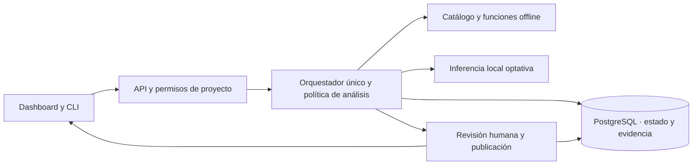

# Roadmap de la plataforma de ciberseguridad ética

## Identidad y experiencia de KronShield

Esta línea de trabajo tiene IDs propios y reutiliza el backlog funcional de este documento. Parte del commit `a79d61a`. El alcance incluye la identidad pública, el frontend y la documentación de producto. La navegación refleja las operaciones que la API ya ofrece y conserva los enlaces de planes, contratos, permisos, datos históricos y comandos existentes.

| ID | Depende de | Entrega | Criterio de aceptación |
|---|---|---|---|
| UX01 | — | Auditoría del frontend y referencia corporativa con procedencia de las fuentes, revisión de la skill externa y decisiones de diseño. | Documentar qué se adopta de BLANDSKRON y qué se adapta para una consola de seguridad. Identificar los flujos, estados y controles que deben preservarse. |
| UX02 | UX01 | Identidad SVG, tipografía local, tokens semánticos y estilos de componentes con tema oscuro, claro y de sistema. | El símbolo se distingue a 16 px, el color no es el único indicador, el foco es visible y los recursos de marca no requieren un CDN. |
| UX03 | UX02 | Shell responsive, landing y acceso, dashboard, tablas, formularios, consulta histórica, planificación y administración. | Los recorridos existentes funcionan con sus roles y estados, la preferencia visual se conserva, los enlaces históricos siguen funcionando y las vistas de revisión no generan actividad sobre objetivos. |
| UX04 | UX03 | Evidencias en Chromium, regresión visual, axe, verificación manual de WCAG 2.2 AA y auditoría Lighthouse. | Capturas para escritorio y móvil, pruebas de teclado y movimiento reducido, métricas reproducibles y resultados pendientes claramente registrados. |
| UX05 | UX02, UX04 | Guía de marca y sistema de diseño dentro de `docs`, README y metadatos web. | Las guías identifican tokens, activos, estados, compatibilidad y cómo repetir la validación visual. |

La implementación y sus verificaciones se documentan en la [guía de marca](docs/BRAND_GUIDELINES.md) y el [sistema de diseño](docs/DESIGN_SYSTEM.md). La evaluación local usa Chromium y datos sintéticos. El piloto completo con Compose se valida con su recorrido de CI.

**Decisión de arquitectura.** Ampliar el piloto con un único orquestador de IA por análisis, nueve especialidades declarativas y una composición Rainbow. La persona elige el modo en el dashboard del proyecto. La aplicación determina qué evidencias puede leer, qué funciones locales puede invocar y qué resultado puede publicar. El resultado del análisis es una evaluación documentada, una simulación de mesa o una propuesta de remediación revisable. La ejecución contra objetivos permanece en `disabled` en todas las fases.

**Línea base.** 24 de noviembre de 2026, rama `main`, commit `9e438034a5929dc171a2290dac184c0c0917a6fe`, árbol inicialmente limpio. Las rutas y los símbolos de la auditoría corresponden a esa revisión. Las tablas de tareas describen trabajo futuro. [Árbol auditado](https://github.com/Blandskron/KronShield/tree/9e438034a5929dc171a2290dac184c0c0917a6fe)

## 1. Auditoría de la base real

Se inventariaron 140 archivos versionados. Se cruzaron las entradas CLI y HTTP con servicios, modelos, migraciones, permisos, pasos de CI y pruebas. Se inspeccionaron los manifiestos y archivos de bloqueo Python/Node, el empaquetado, Compose, el contrato generado y el índice de planificación anterior. Los recursos binarios de marca y las dependencias transitivas se consideraron parte del inventario. No se evaluaron servicios de terceros, datos de clientes ni vulnerabilidades de cada binario distribuido.

| Ref. | Evidencia en el repositorio | Resultado y consecuencia para el diseño |
|---|---|---|
| E01 | [Entrada Typer](cli/entrypoint.py), [planificador local](application/audit_service.py), [comandos de auditoría](cli/audit.py) | `audit plan` contempla `web-baseline` y `tcp-baseline`. `audit run` y el punto de entrada legado cierran la vía activa. `audit analyze` procesa capturas guardadas. Los colores necesitan un identificador separado de estos perfiles. |
| E02 | [Política de alcance](application/policy.py), [destinos canónicos](domain/targets.py), [mandatos](domain/authorization.py), [resolución](application/resolve_target.py), [transporte](adapters/transport.py), [presupuesto](domain/budget.py) | Existen reglas de exclusión, ventana temporal, entorno, atribución, técnica, DNS y transporte acotados. El presupuesto de transporte es local al proceso. El catálogo de análisis usará la política aplicable y funciones sobre datos; los adaptadores DNS/HTTP/TCP quedan fuera de su registro. |
| E03 | [Identidad HTTP](adapters/api/auth.py), [OIDC](adapters/api/oidc.py), [piloto](infra/pilot_auth.py), [roles](application/access.py), [transacciones](infra/tenancy.py) | OIDC o login local de piloto, bearer CLI, sesión web con origen y CSRF. La autorización usa membresías verificadas y contexto de transacción. `viewer` lee, `operator` gestiona evaluaciones/solicitudes, `approver` decide mandatos y `project_admin` gestiona el proyecto. Los equipos serán modos de trabajo, sin herencia de privilegios. |
| E04 | [API de mandatos y archivos](adapters/api/engagements.py), [decisiones](infra/engagements.py), [AES-GCM](application/documents.py), [políticas PostgreSQL](migrations/versions/0003_engagements.py) | El PDF de hasta 1 MiB se cifra con contexto de organización, proyecto, documento y digest. Hay revisiones y separación solicitante/aprobador. El acceso a documentos es más estrecho que la lectura general del proyecto. Mantener los PDF fuera del contexto de IA. |
| E05 | [Esquema del plan](adapters/api/contract.py), [`review`](application/scope_review.py), [`create_plan` y `verify_plan`](infra/scope_reviews.py), [tablas](migrations/versions/0004_scope_review.py) | `ReviewInput` y el plan v1 identifican exclusivamente `scope-review`. El hash cubre `project_version`, mandato, límites y activos. Se registra plan, evento y outbox en una transacción. La verificación reconstruye el estado; la instantánea histórica sigue siendo legible tras un cambio. El outbox actual documenta un único tipo de evento. |
| E06 | [Shell y resumen](frontend/src/main.tsx), [consultas](frontend/src/api.ts), [planificador](frontend/src/features/planning.tsx), [CLI del piloto](cli/web.py) | El dashboard ya cambia de organización/proyecto, obtiene permisos, muestra formularios y abre planes por enlace profundo. React Query ya delimita la caché por identidad y proyecto. El selector de especialidad, sus requisitos y su historial compartido no existen. |
| E07 | [Entrada de informes](application/report_input.py), [CLI de informes](cli/report.py), [cliente Groq](gpt/client.py), [render HTML](reports/report_html.py) | El único uso público de IA es `report generate --with-ai`. `summary_input()` entrega tipo y detalle. El detalle es texto libre. La respuesta es texto; el HTML la escapa. El nuevo servicio necesita proyección por permisos y clasificación, referencias verificables, presupuesto y revisión. El plan v1 tiene un informe determinista independiente. |
| E08 | [Modelos de hallazgo](domain/models.py), [análisis de capturas](tests/test_offline_probes.py), [importador](application/legacy_import.py), [API legada](adapters/api/legacy.py), [guardado local](application/save_result.py) | Ya se distinguen observación, sospecha e inconcluso. JSON/SQLite históricos entran como `legacy/unverified`, con deduplicación por origen en el proyecto. `audit save` conserva JSON/SQLite y recupera fallos parciales. Reutilizar los lectores y los estados de origen; versionar la decisión humana por separado. |
| E09 | [Carga legada](adapters/api/legacy.py), [carga del mandato](adapters/api/engagements.py) | Ambas rutas autentican la petición y acotan bytes, pero consumen el cuerpo antes de comprobar el permiso específico de proyecto en la ruta de persistencia. Esto permite consumo previo al rechazo. Comprobar el permiso antes de leer y repetirlo al guardar es una mejora concreta para estas rutas y para los nuevos formatos. |
| E10 | [Despliegue](compose.yaml), [imagen](Dockerfile), [allowlist de build](.dockerignore), [paquete](pyproject.toml), [operación y recuperación](docs/OPERATIONS.md) | API y PostgreSQL 17 usan redes internas; solo el gateway publica en loopback. Redis y SeaweedFS están en otra red. El flujo offline persiste en PostgreSQL. El wheel enumera paquetes y el build copia rutas explícitas. Cualquier catálogo debe funcionar desde instalación limpia. Ya hay un ensayo documentado de restauración de base y clave. |
| E11 | [Contrato](contracts/openapi-v1.json), [exportador](contracts/export.py), [workflow](.github/workflows/python-app.yml), [bloqueo de red en pruebas](tests/conftest.py), [integración PostgreSQL](integration/test_postgres_tenancy.py), [E2E](frontend/tests/pilot.spec.ts) | OpenAPI 3.1.0 contiene 37 rutas y 52 operaciones. Hay seis migraciones hasta `0006_pilot_memberships`, 21 módulos `tests/test_*.py` y dos módulos de integración. CI ya cubre aislamiento real, compatibilidad, build, accesibilidad y paridad CLI/web después de reiniciar. Extender estos gates. |
| E12 | [Estado del piloto](docs/STATUS.md), [diseño IA anterior](docs/planning/AI_ARCHITECTURE.md), [backlog anterior](docs/planning/TASK_BACKLOG.md) | El diseño histórico enumera diez analistas y contiene fases para jobs y ejecución de red. Son propuestas anteriores. El mandato actual exige un agente y análisis acotado. El campo `organization.kill_switch` ya se consulta en la simulación; falta una operación de gestión expuesta para detener análisis en curso. |

### Verificación de esta revisión

| Comprobación | Evidencia y alcance |
|---|---|
| Suite hermética local | Python 3.10.21, pytest 9.2.0, `python -m pytest tests -p no:cacheprovider -q -rs`. 320 pasaron y 1 se omitió en Windows por permisos para crear un enlace simbólico de directorio. `tests/conftest.py` inhabilita DNS y conexiones en ese proceso. |
| Contrato, lint y build | `python -m contracts.export --check` y flake8 con `--select=E9,F63,F7,F82` finalizaron con código 0. `npm --prefix frontend run build` pasó con Node 24.15.0. `docker compose config --quiet` validó el manifiesto. |
| Integración y ejecución de CI | Pasaron los siete trabajos de GitHub Actions del mismo SHA, incluida la matriz Windows/Linux, PostgreSQL, contrato/web con Playwright y piloto Compose. `oasdiff` se ejecuta en pull requests y esta ejecución correspondió a un push. El daemon Docker local estaba detenido. La prueba de arranque y PostgreSQL procede de CI. [Ejecución 45255530462](https://github.com/Blandskron/KronShield/actions/runs/45255530462) |

La auditoría estática de este documento se apoya en la inspección del repositorio, tres revisiones paralelas por área y las comprobaciones anteriores. La herramienta de análisis profundo de Codex Security no devolvió un informe verificable en esta sesión. Sus resultados no se usan como evidencia de cobertura.

**Reconciliación del backlog.** Conservar TASK-001–013 y 015–020 como base. De TASK-014, 025 y 041 se reutilizan instantáneas, recorrido de publicación y restauración ya presentes. De 026–028 y 035–038 se recuperan proyección, presupuesto, revisión humana y procedencia en las tareas nuevas. El dispatcher de TASK-021, el runner de 022, los jobs de red de 024/029–030 y el flujo de 034 quedan fuera de este alcance. La necesidad de cancelación de 023 sí aplica a los análisis locales. Las tareas nuevas usan identificadores propios para que una IA no confunda un diseño histórico con un requisito vigente. [Estado por tarea](docs/STATUS.md) · [Planificación original](docs/planning/README.md)

## 2. Arquitectura objetivo y decisiones

| Decisión | Necesidad demostrada | Elección y condición para revisarla |
|---|---|---|
| D1. Monolito modular | E01, E03, E06, E11. Web y CLI ya comparten API, política y almacenamiento. | Mantener FastAPI/Pydantic, Typer, React/TypeScript/Vite, SQLAlchemy/Alembic y PG17. Dominio puro para catálogo, permisos sobre datos y transiciones; casos de uso en `application`, persistencia en `infra` y adaptadores en `adapters`. Solo separar un componente cuando mediciones identifiquen contención o una frontera de confianza, como inferencia local. |
| D2. Un agente, capacidades explícitas | E05 y E07. Faltan selección de especialidad, contexto autorizado y salidas verificadas. | Una identidad lógica de orquestación mantiene el estado de cada análisis. El modelo devuelve un siguiente paso tipado o un borrador; un despachador determinista admite solo funciones puras previstas por el flujo. Los nueve modos aportan datos y reglas al mismo servicio. Rainbow usa el mismo estado, mandato y presupuesto. |
| D3. Selección independiente del plan | E05 y E06. La versión del proyecto participa del digest v1. | Guardar selección y revisión en una relación propia. Congelar modo, versión, digest y manifiestos de capacidades en cada análisis. Los planes v1 siguen con su verificador, hash y HTML. Una actualización del catálogo afecta únicamente análisis futuros. |
| D4. Aislamiento por proyecto y finalidad | E03–E05. Un mandato de revisión de alcance no expresa qué evidencia puede tratarse con qué fin. | Vincular a un plan revisado una autorización **adicional y más estrecha** para uso offline de evidencia. Incluir capacidades, clases, referencias/digests, activos y tratamiento IA permitido. Aprobar y revocar con identidad distinta del solicitante. Toda operación requiere la intersección de permisos vigentes, alcance v1 y finalidad aprobada. |
| D5. Procesamiento local acotado | E02, E08 y E10. Capturas, resultados de CI y ejercicios admiten funciones puras. | Primer incremento con pasos breves bajo demanda, estado en PG y una petición por paso. Persistir antes y después de invocar el modelo. No sostener una transacción durante inferencia. La UI reanuda desde el último paso confirmado. Introducir cola únicamente si la medición de la fase final justifica trabajo desatendido o aislamiento adicional. |
| D6. Inferencia local optativa | E07 y E10. El piloto está aislado y Groq está acoplado al resumen CLI. | Validar un adaptador a `llama-server` en una red interna exclusiva API/inferencia, con un modelo preaprovisionado de licencia compatible, archivo/digest verificados y montaje de solo lectura. `httpx` existente para la llamada a destino fijo. Sin puertos de host, herramientas del servidor, acceso a objetivos ni descarga de modelos en ejecución. La función de inferencia devuelve JSON sujeto a validación Pydantic del servidor. El modo determinista sigue disponible y rotulado cuando IA está apagada. El uso remoto existente sigue circunscrito al opt-in de CLI. [Servidor llama.cpp](https://github.com/ggml-org/llama.cpp/blob/master/tools/server/README.md) · [Redes internas de Compose](https://docs.docker.com/reference/compose-file/networks/) |
| D7. Integraciones por archivo | E08. Ya existe importación offline. Blue y Yellow precisan evidencia que el formato legado no representa. | Definir JSON acotado para eventos, fixtures de control y procedencia. Aceptar un subconjunto documentado de SARIF 2.1.0 de CI para revisión de código. Importar solo campos necesarios; ningún URI del informe se abre. Usar referencias versionadas a marcos defensivos. Una conexión a SIEM, forja o ticketing requeriría demanda demostrada y una decisión posterior. [OASIS SARIF](https://docs.oasis-open.org/sarif/sarif/v2.1.0/os/sarif-v2.1.0-os.html) |
| D8. Persistencia y evidencia | E04, E05, E08 y E10. El piloto ya restaura y aísla datos en PG. | Guardar proyecciones mínimas acotadas y cifradas, referencias internas, hash del origen y digest de proyección. Distinguir integridad de procedencia y veracidad. Historial de decisiones por inserción y transición atómica. Nadie deduce autoridad de un hash. Mantener informes generados desde instantáneas publicadas y escapadas. |
| D9. Controlar complejidad y coste | E02, E07 y E10. Hay presupuestos de transporte, pero faltan límites compartidos para IA y Rainbow. | Un presupuesto persistido por análisis y límites de admisión por proyecto. Medir latencia, memoria, volumen y tamaño de contexto con fixtures antes de elegir modelo, dimensionamiento o un segundo servicio. Redis/objetos, bases vectoriales, plataformas multiagente y Kubernetes carecen hoy de una dependencia funcional en este recorrido. |

### Recorrido y fronteras de confianza

1. El usuario autenticado abre un proyecto. La API devuelve catálogo, versión seleccionada, permisos efectivos, dependencias disponibles y motivos de bloqueo. El administrador de proyecto guarda un modo compartido. El operador inicia una evaluación con esa revisión o pide al administrador cambiarla.
2. El operador elige el plan v1, sus activos y un manifiesto de evidencia. La revisión offline enumera propósito, capacidades y un vínculo documentado entre el digest de cada fuente y los IDs de activos del plan. El aprobador contrasta esa asociación con el mandato y las condiciones de uso. Aplicar el mismo criterio a SARIF, registros y decisiones de riesgo. Una fuente sin vínculo verificable queda bloqueada. El material sintético se marca como tal y sus resultados describen el ejercicio.
3. El servicio autentica antes de consumir archivos, acota la lectura en streaming, comprueba digest y versión, y vuelve a autorizar al persistir. Cada dato externo, incluidos comentarios de código y telemetría, entra como dato no confiable. Validar tipo, tamaño, profundidad, cantidad y campos. Persistir la proyección mínima; los PDF del mandato y las credenciales siguen fuera.
4. El orquestador recibe una vista redactada y versionada del proyecto. Los mensajes con evidencia están separados de las instrucciones. El modelo puede solicitar la siguiente consulta del manifiesto y citar IDs entregados por el servidor. La aplicación valida el schema, el paso permitido, el contexto, los permisos, el presupuesto y las referencias. Una salida inválida se conserva como estado de error con causa acotada.
5. El flujo registra resultados de las funciones puras, discrepancias y limitaciones. Un revisor humano admite o rechaza cada conclusión y la publicación. Las acciones de remediación son recomendaciones y criterios de comprobación. La verificación usa una nueva evidencia autorizada del mismo control. La aplicación no aplica cambios en sistemas auditados.
6. Cada transición revalida membresía, proyecto, kill switch, autorización actual, caducidad, hash del plan y permisos sobre las fuentes. Confirmación, publicación y cambios de autoridad se ordenan mediante los mismos bloqueos transaccionales de filas de seguridad o un mecanismo de versiones equivalente, con orden estable y sin mantener locks durante inferencia. Si el cambio de autoridad se confirma primero, la transacción posterior descarta el resultado y solo registra el bloqueo con metadatos mínimos. La lectura histórica sigue la ACL vigente del artefacto.

### Modelo de datos, API y concurrencia propuestos

Son contratos objetivo. Las relaciones de proyecto llevan `(org_id, project_id)`, FK compuestas y políticas `ENABLE/FORCE RLS` con rol runtime sin `BYPASSRLS`. El interruptor y su auditoría tienen ámbito organizativo, con autorización explícita y permisos de escritura acotados. Revisar políticas con dos organizaciones, dos proyectos de una misma organización, conexiones recicladas y cambios de rol. [RLS del piloto](migrations/versions/0004_scope_review.py) · [PostgreSQL 17](https://www.postgresql.org/docs/17/ddl-rowsecurity.html)

| Objeto | Datos y regla de consistencia |
|---|---|
| Manifiesto de especialidad | `id, versión, etiqueta, propósito, capacidades, tipos de entrada/salida, herramientas permitidas, versiones de reglas, dependencias, presupuesto máximo, DAG`. Catálogo empaquetado y validado al cargar. Los IDs resuelven contra un registro cerrado de funciones. Sin nombres de módulo, comandos, rutas o URLs aportados por usuario/modelo. Guardar digest sobre JSON canónico y conservar la copia utilizada. |
| Selección del proyecto | Fila/revisión propia con modo, versión de manifiesto, actor y fecha. Un proyecto anterior inicia «sin configurar». Escrituras condicionadas a versión esperada; dos administradores concurrentes obtienen un éxito y un conflicto. El cambio no incrementa `project.version` ni reescribe instantáneas. |
| Permiso de uso de evidencia | ID y revisión, plan y hash, mandatario/solicitante, revisor, decisión, ventana acotada a la del mandato, usos permitidos, IDs de activos, formatos y digests de origen, clasificación, permiso de inferencia y retención. Una ampliación crea una revisión pendiente. Idempotencia por actor/proyecto. Reusar comprobaciones de identidad y revisión, sin actualizar registros v1. |
| Evidencia y observación | Referencia, clase, activo/ámbito aprobado, origen, autor/importador, fecha declarada y recibida, versión del lector, digests y proyección. Listado, lectura, citas y exportación de un derivado requieren acceso vigente a cada fuente. Aplicar esa intersección también a los metadatos y a Rainbow. Reutilizar metadatos legados y del plan conservando `unverified`. |
| Análisis, paso y decisión | Instantánea de configuración y ámbito, entradas exactas, métricas de consumo, cursor, versión y eventos. Clave única por organización, proyecto, actor, operación e `Idempotency-Key`. Comparar el digest de la petición como valor separado y responder 409 si difiere. Una reserva con plazo y una actualización condicionada consolidan un solo resultado. Si se pierde el recibo de inferencia, contabilizar la reserva máxima antes de permitir un reintento explícito. |
| Resultado y publicación | Claim con evidencia referenciada, estado de observación, incertidumbre y recomendación. El revisor añade identidad, motivo, instante y decisión. La publicación fija la versión de entradas, herramienta, política, modelo, prompt, plantilla y resultado. Los borradores permanecen restringidos; el informe publicado conserva las mismas restricciones de lectura. |

**API aditiva.** Bajo `/api/v1/projects/{project_id}` con `org_id` como en el piloto, prever `GET /team-modes`, `GET/PUT /team-selection`, creación/decisión de permisos de evidencia, carga de fuentes y `POST /analyses`. Para un análisis, ofrecer lectura de estado, paginación de eventos, avance de un paso, cancelación, revisión y descarga de informe publicado. Cada nueva ruta pública lleva modelo tipado, `request_id` y error del contrato. Mutaciones web validan origen y CSRF. Usar `Idempotency-Key` para creaciones/reintentos y `If-Match` o precondición equivalente para cambios de versión. Respuestas esperadas: 401 sin sesión, 403 sin permiso, 404 para identidades/referencias ajenas, 409 para idempotencia conflictiva o estado cambiado, 412 para versión caducada, 428 para precondición ausente y 413/422 para entradas no admitidas. El cliente CLI consume la misma API. [Convenciones existentes](adapters/api/engagements.py) · [OpenAPI 3.1.0](https://spec.openapis.org/oas/v3.1.0)

**Estados.** `draft → ready → processing → awaiting_review → published`. `blocked` conserva los motivos; `cancelled` y `rejected` terminan esa revisión. Un fallo de proveedor deja `failed` con su recibo y permite un intento explícito, acotado y vinculado al anterior cuando aún hay permiso y presupuesto. La caducidad de una reserva de paso permite reconciliar su estado; ante uso de inferencia incierto se carga el máximo reservado y se exige una nueva decisión de reintento. Ningún terminal se reabre por cambiar el perfil. Un duplicado exacto devuelve su recibo sin repetir procesamiento. Los tiempos de auditoría y los límites de vigencia se calculan en UTC con el reloj del servidor.

**Autoridad.** `project_admin` configura el modo. `operator` prepara evidencia y solicita/avanza/cancela su análisis. El `approver` recibe permisos específicos para decidir usos y revisar/publicar resultados, con comprobación de actor distinto del solicitante/autor. El `viewer` consulta catálogo y resultados publicados que le permitan las ACL. Conservar las acciones v1. La suspensión organizativa o revocación de acceso prevalece sobre cualquier rol o selección. El interruptor organizativo se expone solo al administrador de esa organización mediante una operación auditada; la reactivación requiere motivo y no reanuda sesiones previas automáticamente.

## 3. Catálogo seleccionable desde cada proyecto

Los nombres de colores son una convención de producto. Se adopta Red como contraste de controles con evidencia, Blue como detección, Purple como validación conjunta, Yellow como ingeniería segura, Orange como transferencia de aprendizaje al desarrollo, Green como remediación y operación, White como arbitraje de alcance, Black como ejercicio de resiliencia y Gold como gobierno de riesgo. La descripción funcional aparece junto al color en el dashboard. El catálogo tiene nueve especialidades y una décima opción, Rainbow Team.

Todas las herramientas indicadas son funciones de aplicación con entrada/salida tipada sobre material autorizado o sintético. Las que ya existen se enlazan en E01–E12. Los comparadores, lectores y rúbricas nuevos se identifican en la columna de dependencias. Los paquetes de reglas, catálogos y escenarios llevan versión, procedencia, licencia, digest y un fixture con resultado esperado. El manifiesto expone si la dependencia está instalada y si hay evidencia suficiente para ese caso.

| Modo y propósito | Herramientas, dependencias y entradas preconfiguradas | Flujo por defecto → salida verificable |
|---|---|---|
| **Red Team · revisión de exposición** | Lectores de capturas guardadas, `core.xss.analyze` y `core.sqli.analyze`, proyección del hallazgo. Captura y baseline del mismo activo/contexto, tipo de contenido y marcador de la captura cuando proceda. | Comparar material existente → clasificar observación/sospecha/inconcluso → citar diferencias y sugerir el control a revisar. Una firma presente en la base conserva su incertidumbre; una respuesta de prueba ausente queda inconclusa. |
| **Blue Team · detección y triaje** | Lector JSON de eventos minimizados y comparador de campos contra una regla local fija. Fixture con fuente, ventana, claves permitidas y etiqueta de resultado esperado. Se admite referencia de versión/ID a una regla Sigma revisada cuando corresponda. | Normalizar → ordenar en UTC → aplicar la comparación declarada → mostrar eventos coincidentes, faltantes y limitaciones. El fixture contiene un positivo y un negativo; la falta de telemetría queda «sin datos». [Formato de reglas Sigma](https://sigmahq.io/docs/basics/rules.html) |
| **Purple Team · cobertura de detección** | Matriz de controles y comparador de esperado/observado. Requiere escenario sintético autorizado con resultado esperado y observaciones Blue sobre ese escenario. IDs defensivos ATT&CK opcionales en un catálogo local fijado. | Alinear escenario, control y ventana → comparar evidencias → distinguir detectado, falta de detección con datos completos y falta de datos. Un marcador sin fuente válida no suma cobertura. [Datos de MITRE ATT&CK](https://attack.mitre.org/resources/attack-data-and-tools/) |
| **Yellow Team · revisión de código** | Lector SARIF 2.1.0 de un productor CI aprobado, `ruleId`, ubicación relativa, revisión del repositorio y fragmento autorizado cuando exista. Revisor de requisitos ASVS y referencias SSDF versionadas. | Validar procedencia → relacionar regla, revisión y fragmento → explicar el control afectado → proponer criterio de revisión de código. Un resultado sin fragmento puede citar SARIF, pero debe identificar la limitación; no se abre la ruta ni se ejecuta el código. [OASIS SARIF](https://docs.oasis-open.org/sarif/sarif/v2.1.0/os/sarif-v2.1.0-os.html) · [OWASP ASVS 5.0.0](https://asvs.owasp.org/) |
| **Orange Team · aprendizaje de desarrollo seguro** | Constructor de ficha didáctica y rúbrica versionada. Necesita un caso Red o Yellow revisado con permiso de reutilización, o un caso sintético autorizado equivalente; destinatario y objetivo de aprendizaje. | Extraer el error de diseño → redactar ejemplo defensivo desidentificado y ejercicio de revisión → puntuar respuesta contra rúbrica. La ficha enlaza el control y su evidencia accesible; omite identificadores del cliente en el material de formación. |
| **Green Team · remediación verificable** | Comparador local antes/después y ficha de cambio. Requiere observación revisada, dueño, criterio esperado y prueba posterior del mismo activo/control bajo el mismo comparador. | Acordar criterio → comparar dos evidencias inmutables → emitir «mejora observada», «persiste» o «inconcluso» → decisión humana. Dos activos o analizadores no comparables no cierran el hallazgo. |
| **White Team · alcance y arbitraje** | Lector proyectado del plan/decisiones y comprobador de reglas de autorización. Depende de la instantánea con hash, identidad de rol y motivo de cada decisión; solo metadatos autorizados del mandato. | Revisar vigencia y separación → cotejar activos, exclusiones y finalidad → acta de cobertura y excepciones con responsables. Un plan bloqueado se muestra como bloqueo en la admisión; el modo no aprueba mandatos ni cambia el resultado del plan. |
| **Black Team · resiliencia en ejercicio de mesa** | Motor de escenarios de estados finitos con tarjetas de incidencia y rúbrica. Entradas sintéticas versionadas, dependencias del servicio declaradas, decisiones humanas y, si existen, evidencias autorizadas de recuperación. | Simular en memoria la pérdida de una dependencia → comparar decisiones con el objetivo de continuidad → registrar brechas y responsable. Los tiempos simulados se distinguen de tiempos medidos; ningún servicio real cambia de estado. [Guía NIST de ejercicios](https://csrc.nist.gov/pubs/sp/800/84/final) |
| **Gold Team · riesgo y priorización** | Agregador de hallazgos revisados, tabla de impacto/criticidad declarada por el propietario y plantilla ejecutiva. Depende de decisiones trazables y fecha de corte. | Agrupar por control/activo → mostrar evidencia, impacto, incertidumbre y prioridad razonada → exportar decisiones pendientes y sus dueños. Faltas de criticidad se muestran «por determinar»; se conserva el denominador y la fecha. [NIST CSF 2.0](https://nvlpubs.nist.gov/nistpubs/CSWP/NIST.CSWP.29.pdf) |
| **Rainbow Team · evaluación integral** | Compositor de los nueve manifiestos, almacén de resultados y presupuesto común. Congela versiones y dependencias. El operador ve las nueve etapas con su condición y datos faltantes antes de solicitar la revisión. | White comprueba admisión → Red, Blue, Yellow y Black aportan observaciones → Purple contrasta cobertura → Orange y Green elaboran aprendizaje y remedios → Gold integra lo revisado. La revisión humana es una pausa retomable donde haya dependencias de aceptación. Publica una matriz de nueve filas con estado, evidencia, lagunas, conflictos y acciones. |

**Semántica de Rainbow.** Orden topológico estable con las capacidades comunes deduplicadas por `(capacidad, versión, digest de entrada, política, proyecto)` dentro del mismo análisis. Una entrada referenciada por dos colores solo se computa una vez y conserva ambas procedencias. Diseño de salida compuesto: `completo` exige las nueve etapas satisfechas y sus revisiones; `parcial` identifica etapas omitidas por falta de evidencia o dependencias. Revocación, cruce de ámbito o kill switch bloquean el conjunto. Una etapa sin datos no se traduce en cero hallazgos. Las conclusiones incompatibles permanecen visibles hasta la revisión. Gold solo consume decisiones revisadas, también cuando se ejecuta por separado.

**Interacción en el dashboard.** En el resumen, mostrar «Especialidad del proyecto», misión y modo actual. El detalle desplegable enumera entradas, herramientas, dependencias/versión, uso de IA, tratamiento de datos, coste máximo admitido y muestra de salida. Antes de iniciar, el planificador lista faltantes y estados por texto e icono. La propuesta de cambio presenta su efecto en el próximo análisis. Un lector puede consultar y un administrador puede modificar. El usuario navega por teclado, conserva el foco tras una decisión, recibe confirmación accesible y ve la diferencia entre «IA local disponible», «modo determinista» y «análisis bloqueado». La historia se abre por ID incluso si el proyecto tiene otro modo actual. Al cambiar de proyecto, cancelar consultas en vuelo y limpiar formularios/resultados de la vista previa. [WCAG 2.2](https://www.w3.org/TR/WCAG22/) · [Pruebas de accesibilidad con Playwright](https://playwright.dev/docs/accessibility-testing)

### Estándares que modifican una decisión del plan

| Referencia primaria | Aplicación comprobable |
|---|---|
| [NIST CSF 2.0](https://nvlpubs.nist.gov/nistpubs/CSWP/NIST.CSWP.29.pdf) y [NIST SP 800-61r3](https://csrc.nist.gov/pubs/sp/800/61/r3/final) | Gold agrupa resultados por objetivo y dueño. Blue/Black distinguen detección, respuesta y recuperación documentadas. Un mapeo aporta contexto y exige referencia a evidencia. |
| [NIST SSDF 1.1](https://csrc.nist.gov/pubs/sp/800/218/final) y [OWASP ASVS 5.0.0](https://asvs.owasp.org/) | Yellow y Orange enlazan cada criterio técnico con identificador y versión; Green conserva prueba del cambio. La ficha distingue requisito, observación y decisión de revisión. |
| [NIST AI RMF](https://www.nist.gov/itl/ai-risk-management-framework) y [OWASP sobre inyección de instrucciones](https://genai.owasp.org/llmrisk/llm01-prompt-injection/) | Mantener evaluación por versión del modelo y del prompt, autoridad en el servidor, casos de abstención, validación de citas y corte de presupuesto. La calidad se mide por especialidad y por idioma de uso. |
| [SARIF 2.1.0](https://docs.oasis-open.org/sarif/sarif/v2.1.0/os/sarif-v2.1.0-os.html), [Sigma](https://sigmahq.io/docs/basics/rules.html) y [ATT&CK](https://attack.mitre.org/resources/attack-data-and-tools/) | SARIF es el contrato de intercambio con CI. Sigma y ATT&CK aportan procedencia/etiquetas locales. El comparador inicial declara exactamente qué campos y condiciones acepta; rechaza expresiones fuera de ese subconjunto. |
| [WCAG 2.2](https://www.w3.org/TR/WCAG22/) y [OpenAPI 3.1](https://spec.openapis.org/oas/v3.1.0) | Selector por nombre, teclado, foco visible y estados anunciados. Validar contrato compartido y compatibilidad de clientes. Complementar axe con prueba manual del recorrido real. |

## 4. Plan de implementación por dependencias

**Contrato de entrega por tarea.** Cada fila describe una unidad integrable con un resultado observable. Una IA debe leer los archivos E citados en la fase, tomar únicamente la fila y sus predecesoras ya integradas, y producir el cambio mínimo, su prueba y el resultado del gate indicado. Las ramas que comparten una migración o un contrato generado se integran en secuencia y recalculan su base. Para rutas públicas, modelos → OpenAPI → tipos TS en el mismo cambio; para migraciones, actualizar la revisión esperada por `/ready`. Toda prueba nueva usa datos sintéticos. La evidencia de cierre incluye SHA, comando, versiones, conteos, omisiones justificadas y resultado observado. Un check omitido se registra como pendiente. En un fallo se conserva la última versión aprobada y se entrega el caso mínimo que el siguiente implementador pueda verificar.

### Fase A · contrato, compatibilidad y selección de proyecto

Partir de E03, E05, E06, E10 y E11. Entrega visible: abrir el resumen del proyecto y seleccionar un modo persiste una preferencia compartida. El catálogo informa «pendiente» para una capacidad cuya implementación todavía no ha pasado su gate.

| ID | Depende de | Cambio acotado y punto de partida | Criterio de aceptación y gate |
|---|---|---|---|
| A01 | — | Fijar fixture v1 de plan revisado, fecha controlada, HTML y digest; ampliar `tests/test_scope_review.py` / integración con caso de proyecto existente. | Lectura, verificación y bytes de informe iguales en la revisión base. Revocar o vencer el mandato cambia el resultado de verificar, no la lectura histórica. G0. |
| A02 | — | Modelar el manifiesto y el registro cerrado en `domain` con los diez IDs y los contratos de la tabla de modos. Definir versión, requisitos, orden, límites y digest canónico. | Prueba de tabla enumera 9 + 1, detecta ciclos, IDs duplicados, dependencia desconocida y herramienta no registrada. Un modo pendiente es visible e inelegible para análisis. G1. |
| A03 | A01, A02 | Añadir relación de selección por proyecto con FK, versión y RLS mediante Alembic; usar el patrón de `0004_scope_review`. | Desde 0006, un proyecto poblado empieza sin selección; dos proyectos guardan decisiones diferentes. `project.version`, hash y HTML v1 sobreviven. Restauración en copia y `/ready` 200 con head, 503 con esquema anterior. G2. |
| A04 | A03 | Exponer catálogo y lectura/escritura condicionada de selección en `adapters/api`. Guardar actor y fecha con la revisión. | `project_admin` cambia el modo, lector lo consulta, operador sin permiso recibe 403, ajeno 404; carrera produce una sola revisión nueva, cambio obsoleto 412 y ausencia de precondición 428. ACL/CSRF en servidor. G2, G3. |
| A05 | A04 | Integrar selector y detalle en el resumen React con los tipos generados, los permisos de `/me` y las claves de React Query existentes. | Se puede configurar cualquiera de las diez opciones. El cambio persiste al recargar. Proyectos nuevos muestran estado vacío; al pasar A→B una respuesta tardía de A no modifica B. Vista de solo lectura si procede. Teclado y estados accesibles. G4. |
| A06 | A04 | Incorporar consulta/selección a Typer consumiendo la nueva API; reutilizar sesión y contexto del proyecto de `cli/web.py`. | CLI y web leen el mismo modo y revisión; mismo conflicto si dos clientes actualizan sobre la misma versión. Cliente antiguo sigue leyendo plan v1. G3. |

### Fase B · autorización de datos y custodia

Partir de E02–E05 y E08–E09. Esta fase hace verificable quién autorizó qué datos, en qué proyecto y para qué operaciones offline.

| ID | Depende de | Cambio acotado y punto de partida | Criterio de aceptación y gate |
|---|---|---|---|
| B01 | — | Adelantar el control de permiso en las dos cargas existentes de E09; conservar límites, dobles comprobaciones y contrato de éxito. | Un doble de stream registra cero bytes leídos ante 403/404. Revocación entre admisión y persistencia impide guardar; la conexión DB queda libre durante la lectura. Fixtures válidos y límites históricos pasan. G0, G2. |
| B02 | A02 | Definir en `application` la política pura de uso de evidencia y las acciones específicas de aprobación/publicación. Reusar roles y política v1. | Tabla de verdad con permitido y denegados para finalidad, identidad, activo, clasificación, modo, digest, tiempo, actor idéntico, tercero, plan bloqueado y cruce de proyecto; misma decisión para los diez modos. G1. |
| B03 | A03, B02 | Persistir y exponer la solicitud, decisión y revocación del permiso de evidencia con FK al plan, revisión y decisión inmutables. | Solo el operador propone y un aprobador distinto decide; revisión nueva requiere decisión nueva, no amplía una autorización previa. Una carrera aprobar/revocar tiene orden único y auditable. RLS protege lecturas y escrituras directas con rol runtime. G2, G3. |
| B04 | B03 | Implementar ingreso común de evidencia por digest y clase, preautorización y recibo idempotente; proyección mínima cifrada y asociada al tenant con un contexto criptográfico específico de evidencia. | Coinciden digest/tamaño/tipo autorizados o la carga se rechaza sin persistencia parcial. Dos cargas iguales en el mismo ámbito devuelven el mismo recibo; otro proyecto nunca comparte recibos ni deduplicación visible. El cambio de org/ID rompe la autenticación del cifrado. G1, G2. |
| B05 | B04 | Incorporar vista de evidencia del plan y del legado para el orquestador en `application`, con lista positiva de campos y clasificación. | Dos actores del proyecto con ACL distintas ven proyecciones distintas. IDs ajenos, PDF, encabezados crudos, query de URL, secretos sintéticos y texto libre sin clasificar quedan fuera. `legacy/unverified` se conserva. G1, G2. |
| B06 | B04 | Introducir vencimiento y retirada de proyecciones y derivados por proyecto. Fijar retención aprobada por clase, alcance en copias y registro mínimo de disposición. | Un reloj controlado vence un artefacto; lector, IA y exportador dejan de recibir contenido, se invalidan derivados afectados y queda recibo con motivo. Una restauración reaplica vencimientos antes de habilitar lectura. Verificar copia/clave por separado. G2, G7. |
| B07 | B03 | Exponer administración del `kill_switch` existente con permiso organizativo, motivo, registro y protección de concurrencia. | El administrador de la organización puede detener y reactivar; un administrador de otro tenant recibe rechazo. Planes v1 reflejan el bloqueo al revalidar. Reactivar no revive análisis caducados o cancelados. G2, G3. |

### Fase C · orquestador y revisión humana

Partir de E05, E07 y E10. Entrega visible: una solicitud produce un borrador con citas y un recibo de revisión. El mismo recorrido admite evidencia insuficiente, cancelación y ausencia de modelo.

| ID | Depende de | Cambio acotado y punto de partida | Criterio de aceptación y gate |
|---|---|---|---|
| C01 | B03, B05 | Crear instantánea, historial de pasos y registro idempotente del análisis en PG. Aplicar el patrón transaccional de `infra/scope_reviews.py` en tablas nuevas. | Dos clientes con la misma clave/contenido reciben un ID; distinto contenido devuelve 409. Fallo entre escrituras revierte el paso y su evento. Reconstrucción conserva plan, modo y digest anterior tras cambiar la selección. G2. |
| C02 | C01, B07 | Implementar el despachador determinista y la máquina de estados por pasos en `application`. Usar registro de A02 y revalidar contexto al iniciar y confirmar. | Solo se admiten herramientas y transiciones del manifiesto. Una capacidad desconocida, un proyecto archivado o un mandato revocado generan bloqueo auditable. Un backend falso registra cero accesos a shell, transporte objetivo y sistema de archivos arbitrario. G1, G2. |
| C03 | C01 | Reservar presupuesto compartido en PG por análisis/proyecto y fijar límites de bytes, pasos, solicitudes de inferencia, tokens, tiempo y concurrencia. | Dos peticiones concurrentes no superan el máximo. Coste desconocido conserva la reserva, timeout termina el intento, Rainbow usa una sola cuenta y el doble envío no factura dos resultados. Publicar valores piloto explícitos y su ficha de medición. G2, G5. |
| C04 | B05, C02, C03 | Implementar contrato de orquestación IA con proveedor falso: esquema estricto de propuesta, siguiente paso de lectura o borrador con citas; registrar versión de política, prompt y modelo. | Instrucción incrustada en evidencia, cita inventada, parámetro extra, referencia ajena, JSON inválido o petición fuera de presupuesto se rechazan. Caso válido produce borrador y caso sin sustento se abstiene. El falso permite repetición en CI. G1, G5. |
| C05 | C04 | Evaluar e integrar **un** proveedor local mediante destino interno fijo y perfil de Compose optativo. Fijar versión de servidor, modelo/digest, licencia y recursos según ensayo en hardware declarado. | Sesión real en español produce una propuesta admitida por C04; sin pesos disponibles muestra dependencia faltante y mantiene el recorrido determinista. Verificar montaje de solo lectura, ausencia de puertos publicados y egress externo, timeout y contenido mínimo recibido. G5. |
| C06 | C02, C03, B06 | Publicar API de creación, paso, consulta y cancelación por actor autorizado, con recuperación de reservas vencidas y verificación al confirmar. | Dos avances concurrentes consolidan un solo paso; corte entre reserva y confirmación no duplica hallazgos. Si cambia mandato, membresía o kill switch durante inferencia, el resultado queda descartado. Cancelar es idempotente y bloquea pasos posteriores. G2, G3, G5. |
| C07 | C06 | Exponer decisión humana por conclusión y publicación de instantánea en `adapters/api` y `reports`. Usar plantillas escapadas y lista de referencias permitidas. | El autor no publica su borrador; evidencia retirada/ajena bloquea la publicación. Un aprobador autorizado registra motivo e identidad. El mismo resultado publicado produce los mismos bytes tras reiniciar; contenido no confiable se presenta como texto. G2, G3. |
| C08 | A05, B03, B04, C06, C07 | Incorporar en el planificador el recorrido de evidencia, estado de análisis y revisión mediante los endpoints anteriores, con vistas por rol. | Operador ve requisitos y solicita, otro usuario revisa, un lector autorizado descarga. Bloqueo, espera de revisor, modo determinista y error de dependencia son distinguibles. Recargar/reanudar recupera el paso confirmado. G4. |

C01 y C03 incorporan el registro interno de borradores, las reservas y la conciliación en `0011_offline_analysis_ledger`. C02 añade el despacho determinista y recibos por paso en `0012_analysis_step_outcomes`. Las pruebas usan PostgreSQL desechable, consumos sintéticos y un registro de funciones de prueba. [Límites y medición del piloto](docs/OPERATIONS.md#presupuesto-de-análisis-offline)

C04 incorpora el contrato interno y un proveedor simulado reproducible en CI. La preparación comprueba el siguiente paso del manifiesto congelado, solicita la proyección con permiso de inferencia local y calcula el cupo con el presupuesto del análisis. El proveedor recibe instrucciones separadas de los datos. Cada cita de un borrador debe sustentar la misma observación estructurada. Cuando una fuente solo aporta un resumen legado, conserva su confianza sin verificar. La ausencia de evidencia para el paso genera abstención sin consumir cupo.

El recibo interno de C04 devuelve las versiones de política, prompt y modelo, junto con los consumos y el resultado tipado o la causa acotada de rechazo. Las pruebas de contrato están en `tests/test_analysis_proposals.py`. C05 valida llama.cpp y Qwen mediante un perfil de Compose independiente con destino interno fijo. El ensayo en español produjo tres borradores idénticos admitidos por C04. También se verificaron el aislamiento y el estado de dependencia faltante. [Configuración y resultados del ensayo](docs/OPERATIONS.md#ensayo-de-inferencia-local)

C06 publica la creación, el avance, la consulta y la cancelación del análisis offline. La migración `0013_analysis_lifecycle` registra cancelaciones y recibos privados de inferencia. Las pruebas con PostgreSQL comprueban la recuperación de reservas vencidas, la idempotencia concurrente y el descarte de resultados cuando cambian el mandato, el interruptor o la membresía antes de confirmar. La API usa la revisión de registros de alcance como capacidad offline inicial. [Contrato operativo de análisis](docs/OPERATIONS.md#api-de-análisis-offline)

C07 registra decisiones humanas por conclusión y publica un HTML inmutable con digest y procedencia mediante `0014_analysis_publication`. El aprobador autorizado debe ser distinto del autor. La lista de fuentes del análisis se revalida tanto al publicar como al descargar. Las pruebas de integración verifican la retirada de acceso, las referencias ajenas, la persistencia del HTML byte por byte y el tratamiento de texto no confiable. [Revisión y publicación](docs/OPERATIONS.md#revisión-y-publicación-de-análisis)

C08 incorpora al planificador el recorrido de White Team, desde la solicitud de evidencia hasta la descarga autorizada. Los enlaces mantienen proyecto, permiso y análisis, y las consultas recuperan el paso confirmado y la publicación al volver. Playwright cubre ambos roles, la denegación de descarga, la reanudación, la falta de proveedor y el análisis de accesibilidad. [Flujo de análisis offline](docs/OPERATIONS.md#api-de-análisis-offline)

### Fase D · habilidades y flujos de las nueve especialidades

Cada fila entrega una función o un flujo tipado y su fixture positivo y negativo. Montar cada flujo sobre C02 y los datos autorizados de B04/B05. Activar el modo individual en A02 solo después de pasar G6. Usar fixtures pequeños con salidas esperadas versionadas, independientes de cualquier respuesta de IA.

| ID | Depende de | Cambio acotado | Criterio de aceptación y gate |
|---|---|---|---|
| D01 | B04 | Añadir lector de pares de capturas para Red sobre los formatos offline de `cli/audit.py`. Validar vínculo con activo, contexto, tipo y fecha. | Admite pareja comparable y deja explícito cuando falta una de las capturas. Rechaza activo ajeno y excedentes. G1. |
| D02 | D01, C02 | Conectar **Red** con `core.xss.analyze` y `core.sqli.analyze` sobre capturas guardadas. | Fixture con señal preexistente mantiene confianza baja. La falta de respuesta queda inconclusa. Se citan captura y baseline y se conserva la incertidumbre. G6. |
| D03 | B04 | Implementada la [importación API de eventos JSON para Blue](docs/OPERATIONS.md#importar-eventos-de-blue-team), con esquema acotado, normalización UTC y procedencia. | Fixture desordenado se lee en orden de tiempo estable. Fecha inválida, tamaño excesivo y fuente ajena se rechazan. G1. |
| D04 | D03, C02 | Implementado el [triaje de Blue en el planificador](docs/OPERATIONS.md#ejecutar-y-revisar-el-triaje), con la regla determinista de fallos de autenticación, revisión e informe. | Fixture sintético produce una coincidencia y un negativo esperados. Lote sin la fuente requerida queda «sin datos». Regla fuera del subconjunto declarado es rechazada. G6. |
| D05 | D04, C02 | Implementada la [matriz Purple de cobertura](docs/OPERATIONS.md#evaluar-cobertura-de-purple-team) por escenario sintético, control y ventana. | Fixture produce un control detectado, un control con datos completos y sin detección, y otro sin datos. El informe identifica denominador y evidencia por fila. G6. |
| D06 | B04 | Incorporar lector SARIF para Yellow con subconjunto fijo, revisión y productor verificables. | La referencia relativa y el ID de regla sobreviven. Rutas absolutas, referencias externas y relaciones a revisiones ajenas se rechazan. Ningún archivo del informe se abre. G1. |
| D07 | D06, C02 | Registrar **Yellow** con mapeo versionado de requisitos ASVS/SSDF y borrador de revisión de código. | El borrador cita ubicación, revisión y criterio o declara mapeo ausente. Con fragmento faltante cita el importado y registra la limitación. G6. |
| D08 | D02, D07, C07 | Registrar **Orange** con plantilla y rúbrica de aprendizaje sobre caso revisado o fixture equivalente. | Un caso permitido genera objetivo, ejercicio de revisión y rúbrica trazable. Caso sin permiso de reutilización queda bloqueado. El material formativo omite identificadores de cliente. G6. |
| D09 | D02, D07, C07 | Registrar **Green** con comparador de evidencias autorizadas antes/después del mismo control. | Fixtures de mejora, persistencia e incomparabilidad devuelven los tres estados de la ficha. Un borrador sin decisión humana conserva el estado de revisión. G6. |
| D10 | B05, C02 | Registrar **White** con lectura proyectada del mandato/plan y acta de alcance. | Acta de plan válido consigna vigencia, exclusiones y responsables. Plan bloqueado muestra su motivo y no admite análisis. Faltantes y datos con ACL más estricta se respetan. G6. |
| D11 | B04 | Modelar las tarjetas, estados y rúbrica de los ejercicios de mesa de Black. | Un escenario sintético completo valida claves y transición esperada. Estado sin destino definido o dependencia no declarada se rechaza. G1. |
| D12 | D11, C02 | Registrar **Black** con simulación de mesa en memoria y ficha de continuidad. | Fixture con caída simulada distingue objetivos, decisiones, tiempo simulado y observación de recuperación aportada. El fixture funciona sin depender de un servicio de cliente. G6. |
| D13 | C07, D09, D10, D12 | Registrar **Gold** con agregación determinista de decisiones revisadas y plantilla con mapeos CSF. | Resultados duplicados no inflan métricas. Se indica fecha de corte, criticidad pendiente, limitaciones y dueño. Los borradores quedan fuera de los totales. G6. |

### Fase E · Rainbow y verificación de historial

| ID | Depende de | Cambio acotado | Criterio de aceptación y gate |
|---|---|---|---|
| E01-R | D02, D04, D05, D07, D08, D09, D10, D12, D13, C03 | Registrar el compositor **Rainbow** y su DAG de nueve etapas con versiones congeladas, deduplicación, pausas de decisión y presupuesto compartido. | Fixture completo visita cada etapa una vez según sus dependencias. Reanudar tras revisión o reinicio conserva cursor y saldo. Un requisito que falta produce salida parcial con su causa. Revocar a mitad bloquea y descarta resultados nuevos. G2, G5, G6. |
| E02-R | E01-R, C07 | Publicar la matriz Rainbow de nueve filas con cobertura, evidencias y resultados discrepantes. | Cada etapa tiene versión y estado. Una capacidad omitida por falta de datos no incrementa el denominador de cobertura evaluada. Referencias y metadatos respetan la intersección de ACL de origen. G2, G6. |
| E03-R | E02-R, C08 | Integrar la vista previa de dependencias, estados por etapa y revisión de Rainbow en el dashboard. | Con teclado se elige Rainbow, se inspecciona disponibilidad de nueve etapas, se retoma la revisión y se descarga la matriz autorizada. Otro proyecto no ve resultados del primero. G4, G6. |
| E04-R | A01, A05, A06, E03-R | Ampliar `frontend/tests/pilot.spec.ts` con un plan histórico v1 creado bajo 0006 y un mandato vigente durante toda la prueba. | Tras migrar, alternar Red → Rainbow → Blue por web/CLI y reiniciar, la URL, el JSON del GET, el hash del plan y el SHA-256 del HTML coinciden con la copia previa. `verify` devuelve `verified` y `execution=disabled`. Revocar el mandato bloquea `verify` y conserva el GET y el informe histórico para quien tenga acceso. Una cuenta de otra organización recibe 404 en las rutas del plan. G0, G2, G3, G4, G7. |

### Fase F · entrega y decisión de escala

| ID | Depende de | Cambio acotado | Criterio de aceptación y gate |
|---|---|---|---|
| F01 | E04-R | Extender smoke del wheel y de la imagen con el catálogo empaquetado. Revisar `pyproject.toml`, `Dockerfile` y `.dockerignore` según las rutas efectivamente añadidas. | La instalación desde otro directorio sirve los diez modos con los mismos digests que el repositorio. Los artefactos distribuidos identifican versiones de dependencias, imagen y modelo optativo. G0, G7. |
| F02 | E04-R, B06 | Ensayar copia/restauración del piloto en un proyecto Compose desechable, usando `docs/OPERATIONS.md` como base. | Restauración conserva plan v1, selección, resultados y sus digests. Vencimientos se reaplican y tokens anteriores se rechazan. Medir RPO/RTO observados con el tamaño del fixture y registrar quién autoriza los objetivos de operación. G7. |
| F03 | E04-R, C05 | Medir admisión, avance, memoria, disputas y latencia de selección/listado y Rainbow sobre fixtures sintéticos en hardware declarado. | Medición repetible con 1, 5 y 20 sesiones de análisis, dos proyectos como mínimo y cargas determinista/IA por separado. Registrar p50/p95, saturación, rechazos, memoria y duración. Revisar SLO con el responsable del piloto antes de habilitar un volumen mayor. G5, G7. |
| F04 | F01, F02, F03 | Publicar las instrucciones de uso y operación de los diez modos, actualización, compatibilidad, dependencia optativa y recuperación. | Un operador distinto puede instalar, seleccionar, analizar, revisar, reproducir un informe y recuperar una copia con el manual y fixtures. Adjuntar las evidencias de G0–G7 al lanzamiento. G7. |

**Cambios sujetos a evidencia.** Si F03 muestra agotamiento reproducible de tiempo de petición o una necesidad de trabajo desatendido, evaluar un trabajador local acotado y una cola durable en PostgreSQL. Exigir recuperación, admisión y cancelación antes de adoptar el cambio. Si crece la evidencia retenida, medir espacio, ventana de backup y restauración antes de evaluar almacenamiento de objetos. Una integración de terceros requiere productor real, contrato de datos, responsable y un fixture verificable. La capacidad actual de importar archivos cubre el primer piloto de los diez modos.

## 5. Quality gates

| Gate | Qué ejecutar y qué debe pasar |
|---|---|
| **G0 · regresión offline** | `uv sync --locked --no-editable --extra api --extra postgres` y `uv run --no-sync python -m pytest` según la matriz de CI. Flake8 fatal con el selector del workflow. El plan y el HTML v1 deben conservar sus bytes de referencia. Bloquear red de objetivos con dobles que registren llamadas. El caso de enlace simbólico omitido en Windows debe pasar en Linux. |
| **G1 · dominio, límites y entradas** | Fixtures positivos/negativos de manifiesto, detectores y parsers. Validar formato, tamaño, clasificación, procedencia, límites y ciclo del flujo. Cero aceptación de herramientas fuera del registro, referencias externas, IDs ajenos o datos clasificados fuera de permiso. |
| **G2 · PostgreSQL y autoridad** | `uv run --no-sync python -m pytest integration` con PostgreSQL 17 desechable y `PENTEST_AGENT_TEST_POSTGRES_ADMIN_URL` configurada. Comprobar desde 0006, RLS real sin skip, rol de runtime, pool reutilizado y referencias cruzadas. Con dos fuentes visibles para `{a,b}` y `{b,c}`, solo `b` ve el derivado. Si se revoca su acceso a una fuente, desaparecen también el contenido y metadatos derivados. Probar ambos órdenes de confirmación/publicación frente a revocación, cambio de membresía y kill switch en dos sesiones. |
| **G3 · contrato y paridad** | `uv run --no-sync python -m contracts.export --check`, `npm --prefix frontend run contract` y cero deriva del cliente generado. En PR, oasdiff contra la base sin incompatibilidades. Comparar errores, estado, revisión, digest e idempotencia entre web y CLI para sus operaciones compartidas. |
| **G4 · dashboard accesible** | `npm --prefix frontend run build` y Playwright con fixture y piloto Compose real usando las instrucciones de desarrollo. Probar 360/768/1440 px, foco, teclado, estado anunciado, sesión y cambio de proyecto, y cero violaciones automatizadas de reglas aplicables. Añadir revisión manual de criterios WCAG 2.2 AA relevantes. |
| **G5 · IA y concurrencia** | Suite hermética con proveedor falso y evaluación del proveedor local con fixtures autorizados. Cero cruces de ACL, citas aceptadas inexistentes, herramienta desconocida admitida, publicación automática o presupuesto excedido. Casos de proveedor ausente, timeout, reintento, revocación y cancelación durante la llamada. Selección de modelo por calidad de cita/abstención y latencia medidas en español. |
| **G6 · especialidades y Rainbow** | Matriz trazable de diez filas, una por modo, en CI. Cada modo pasa fixture positivo y negativo con dependencias y versiones registradas. Rainbow prueba conjunto completo, parcial, detenido y con conclusiones discrepantes. Las simulaciones de mesa y comparaciones de capturas operan con fixtures. |
| **G7 · entrega y recuperación** | Validar `docker compose config --quiet`, build reproducible desde locks y smoke de paquete. Ejecutar restauración documentada en copia y comparar hashes de plan, informe y resultados. Registrar migración/revisión, revocaciones, límites, RPO/RTO y resultados F03. La habilitación general requiere evidencia de todos los gates aplicables. |

Los comandos de G0–G4 reutilizan los entornos y convenciones existentes. Las pruebas de integración, los resultados de CI y los ensayos de modelos o restauración corresponden siempre al SHA que se libera. [Desarrollo](docs/DEVELOPMENT.md) · [Operación](docs/OPERATIONS.md) · [Flujo de CI](.github/workflows/python-app.yml)
