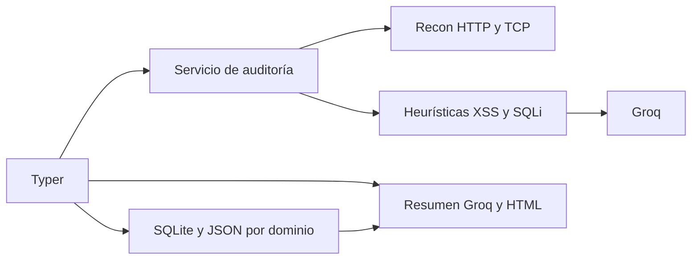
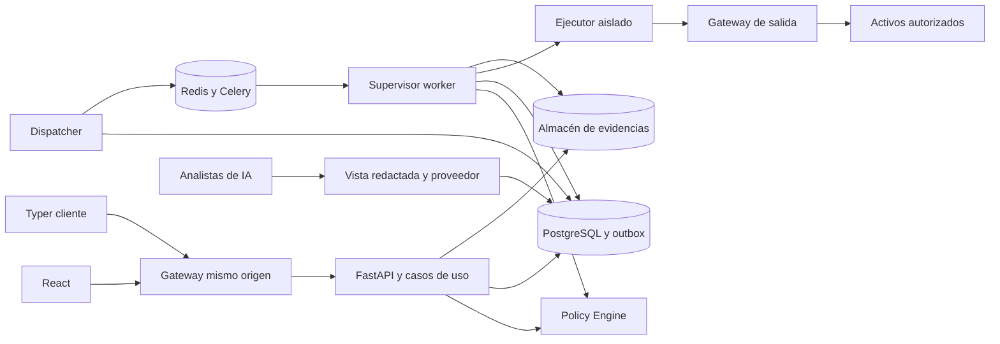

# Arquitectura actual y objetivo

## Arquitectura del piloto offline

El gateway entrega el build de Vite y reenvía la API por una red interna de Compose. FastAPI autentica la sesión, valida los permisos y abre transacciones con el contexto de organización y proyecto. PostgreSQL aplica políticas RLS y conserva inventario, decisiones, documentos cifrados, revisiones y resultados importados. El proceso de migración usa un rol separado del rol de API.

La CLI instalada tiene un flujo local sobre capturas y un cliente HTTP para el piloto. La web y el cliente HTTP usan el mismo contrato OpenAPI para consultar la revisión de alcance y descargar el informe. La API de revisión lee exclusivamente datos persistidos. [Estado del proyecto](../STATUS.md) · [Desarrollo y validación](../DEVELOPMENT.md)

## Arquitectura observada en la línea base

## Arquitectura objetivo

Dependencia de código `domain ← application ← adapters`. Dominio contiene alcance, autorización, estado de job e invariantes de evidencia. Aplicación implementa casos de uso sobre puertos `AuthorizationRepository`, `PolicyEvaluator`, `JobRepository`, `EvidenceStore`, `SafeTransport`, `ToolAdapter`, `IdentityProvider` y `ModelProvider`. Los adaptadores implementan FastAPI/Typer, SQLAlchemy, Celery, transporte pinneado y Groq. El ensamblado de dependencias está en la raíz de cada proceso. Contextos iniciales: identidad, compromisos, ejecución, evidencia y análisis. No requieren microservicios separados.

| Ubicación futura | Contrato |
|---|---|
| `src/pentest_agent/domain`, `application` | Tipos y casos de uso sin IO implícito |
| `src/pentest_agent/adapters/api`, `adapters/cli` | Clientes web y Typer contra la misma API, auth, reportes y eventos |
| `src/pentest_agent/adapters/persistence`, `migrations/` | SQLAlchemy PostgreSQL y Alembic |
| `src/pentest_agent/adapters/tools`, `runner/` | Catálogo tipado, supervisor y perfiles de aislamiento |
| `frontend/`, `deploy/`, `lab/`, `tests/` | Vite, Compose y gateway, fixtures y pruebas |

## Despliegue disponible desde el clon

`compose.yaml` reúne `secrets`, `postgres`, `migrate`, `api`, `gateway`, `redis`, `objects` y el servicio `cli` ejecutado a demanda. El gateway es el único servicio con un puerto de host y escucha en loopback. La UI se compila en una etapa de Node y se sirve desde Nginx. PostgreSQL, almacenamiento y tráfico de API entre contenedores tienen redes internas. [Servicios de Docker Compose](https://docs.docker.com/reference/compose-file/services/)

El arranque genera secretos en un volumen y aplica migraciones antes de habilitar la API. El primer administrador se enrola con un código de un solo uso. El modo OIDC configurable usa un origen HTTPS y credenciales externas. La CLI de Compose conserva el token de piloto en un volumen dedicado. `lab seed` registra un activo sintético en el inventario. El recorrido completo desde el alta hasta el informe se verifica en CI. [Guía operativa y restauración](../OPERATIONS.md)

## Runtime y decisiones de fallos del diseño objetivo

1. API valida actor, proyecto, plan y revisión de alcance. Inserta job y outbox en una transacción. Redis transporta IDs, PostgreSQL es autoridad de estado.
2. Celery puede entregar duplicados. Worker adquiere lease con fencing token y actualiza por comparación. Se permite reintento antes de la primera operación externa; luego, pérdida del lease produce ejecución interrumpida con evidencia parcial. Los eventos se confirman en DB antes de mostrarse. [Workers de Celery](https://docs.celeryq.dev/en/stable/userguide/workers.html).
3. El supervisor lanza un proceso con lista de argumentos y entorno mínimo. La red de herramientas va por gateway con política por flujo y límites compartidos. El runner de producción usa sandbox por trabajo y egress verificado. Herramientas que escapan al proxy se bloquean o requieren perfil dedicado con reglas IP/puerto equivalentes y paridad probada. Los workers no montan Docker socket.
4. SSE ofrece historial paginado y reanudación desde un cursor de job. Prometheus/Grafana y OpenTelemetry quedan en perfil de observabilidad. Los logs y trazas correlacionan identificadores sin URL sensible, credenciales ni payload; métricas agregadas evitan cardinalidad por objetivo.
5. En producción, OIDC externo, PostgreSQL con backups, Redis privado, almacenamiento de objetos cifrado y almacén de secretos son dependencias propias del despliegue. La cola es reconstruible desde outbox y estado. El almacenamiento de evidencia y bitácora tiene política de recuperación independiente del runner.
