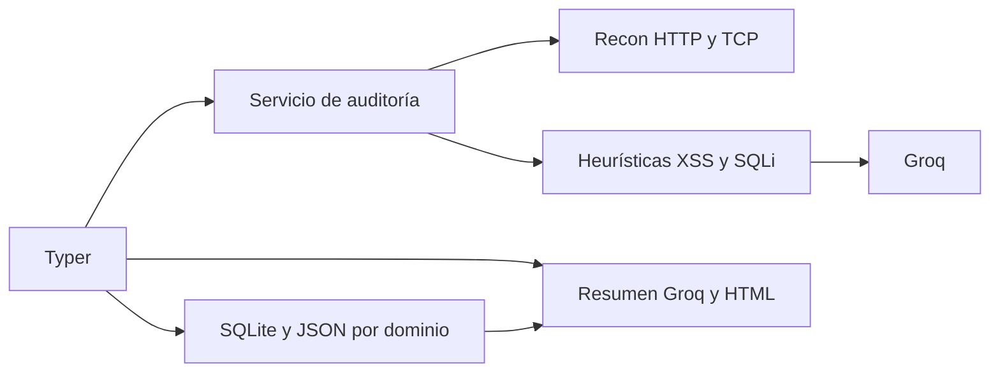
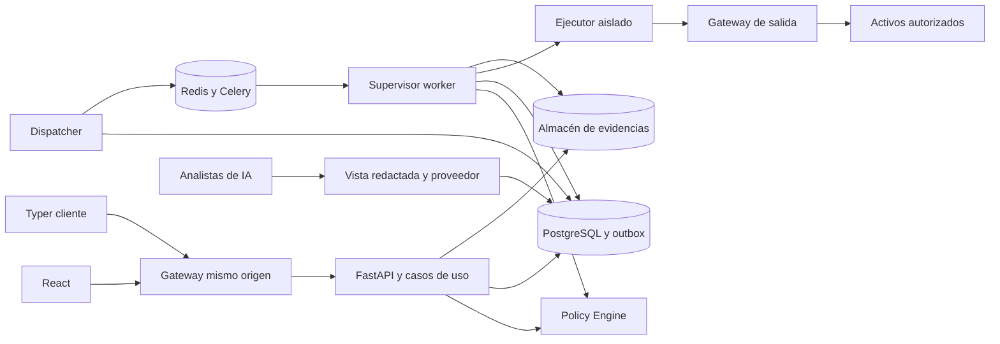

# Arquitectura actual y objetivo

## Arquitectura observada



## Arquitectura propuesta



Dependencia de código `domain ← application ← adapters`. Dominio contiene alcance, autorización, estado de job e invariantes de evidencia. Aplicación implementa casos de uso sobre puertos `AuthorizationRepository`, `PolicyEvaluator`, `JobRepository`, `EvidenceStore`, `SafeTransport`, `ToolAdapter`, `IdentityProvider` y `ModelProvider`. Los adaptadores implementan FastAPI/Typer, SQLAlchemy, Celery, transporte pinneado y Groq. El ensamblado de dependencias está en la raíz de cada proceso. Contextos iniciales: identidad, compromisos, ejecución, evidencia y análisis. No requieren microservicios separados.

| Ubicación futura | Contrato |
|---|---|
| `src/pentest_agent/domain`, `application` | Tipos y casos de uso sin IO implícito |
| `src/pentest_agent/adapters/api`, `adapters/cli` | Clientes web y Typer contra la misma API, auth, reportes y eventos |
| `src/pentest_agent/adapters/persistence`, `migrations/` | SQLAlchemy PostgreSQL y Alembic |
| `src/pentest_agent/adapters/tools`, `runner/` | Catálogo tipado, supervisor y perfiles de aislamiento |
| `frontend/`, `deploy/`, `lab/`, `tests/` | Vite, Compose y gateway, fixtures y pruebas |

## Despliegue desde el clon

Compose es la distribución reproducible de desarrollo y piloto de un solo host. `compose.yaml` declara `gateway`, `api`, `migrate`, `postgres`, `redis`, `objects`, `dispatcher`, `worker`, `egress`, `cli` y el perfil `lab`. La UI se compila en una etapa Node y se sirve desde el gateway. `migrate` sale con éxito antes de que la API esté lista. `.dockerignore` excluye Git, secretos, bases y evidencia local. `.env.example` contiene claves de configuración sin secretos y tiene excepción explícita en `.gitignore`. Las imágenes usan lockfiles y digest, usuarios sin privilegios, capacidades mínimas, raíz de solo lectura donde aplique y volúmenes explícitos. La clave local se genera por instalación mediante bootstrap y se monta como secreto. La aplicación se expone solo en loopback en piloto. PostgreSQL, Redis y objetos se mantienen en redes internas. Los servicios activos se habilitan en v0.5.0 con red de laboratorio aislada. La separación de red y roles se verifica en el host de producción. [Redes de Compose](https://docs.docker.com/compose/how-tos/networking/).

Secuencia objetivo documentada para v0.5.0. Los comandos ilustran el contrato futuro.

```bash
git clone https://github.com/Blandskron/pentest-agent.git
cd pentest-agent
docker compose --profile lab up --build -d --wait
docker compose run --rm cli status
docker compose run --rm cli auth login
docker compose run --rm cli lab seed
docker compose run --rm cli audit plan --project lab --target lab-http --profile web-baseline
docker compose run --rm cli audit run --project lab --plan PLAN_ID --wait
docker compose run --rm cli jobs logs JOB_ID --follow
docker compose run --rm cli report generate --assessment ASSESSMENT_ID --format html
```

Acceso web piloto en `http://localhost:8080`. Primer administrador vía secreto de bootstrap de un solo uso, lectura desde archivo local restringido. El piloto crea una identidad local con credencial propia y sesión revocable en loopback. `auth login` admite esa identidad mediante entrada segura desde el contenedor. En producción, CLI en host usa Device Flow o callback loopback y CLI en contenedor usa Device Flow o credencial de servicio de alcance explícito. El CLI de Compose usa volumen de credencial dedicado con permisos mínimos, revocable. `lab seed` es idempotente, restringido a operador local de laboratorio, crea objetivo y autorización demo vigentes y registra actor. `status` es una sonda sin credenciales con campos mínimos. La exportación de CLI va a stdout o ruta local elegida explícitamente. Compose down preserva datos, y la guía de operaciones describe copias, restauración y limpieza explícita de volúmenes. v0.4.0 verifica clon → login → alta → simulación de plan. v0.5.0 verifica ejecución y entrega de informe determinista. v0.8.0 añade revisión y reportes completos.

## Runtime y decisiones de fallos

1. API valida actor, proyecto, plan y revisión de alcance. Inserta job y outbox en una transacción. Redis transporta IDs, PostgreSQL es autoridad de estado.
2. Celery puede entregar duplicados. Worker adquiere lease con fencing token y actualiza por comparación. Se permite reintento antes de la primera operación externa; luego, pérdida del lease produce ejecución interrumpida con evidencia parcial. Los eventos se confirman en DB antes de mostrarse. [Workers de Celery](https://docs.celeryq.dev/en/stable/userguide/workers.html).
3. El supervisor lanza un proceso con lista de argumentos y entorno mínimo. La red de herramientas va por gateway con política por flujo y límites compartidos. El runner de producción usa sandbox por trabajo y egress verificado. Herramientas que escapan al proxy se bloquean o requieren perfil dedicado con reglas IP/puerto equivalentes y paridad probada. Los workers no montan Docker socket.
4. SSE ofrece historial paginado y reanudación desde un cursor de job. Prometheus/Grafana y OpenTelemetry quedan en perfil de observabilidad. Los logs y trazas correlacionan identificadores sin URL sensible, credenciales ni payload; métricas agregadas evitan cardinalidad por objetivo.
5. En producción, OIDC externo, PostgreSQL con backups, Redis privado, almacenamiento de objetos cifrado y almacén de secretos son dependencias propias del despliegue. La cola es reconstruible desde outbox y estado. El almacenamiento de evidencia y bitácora tiene política de recuperación independiente del runner.
